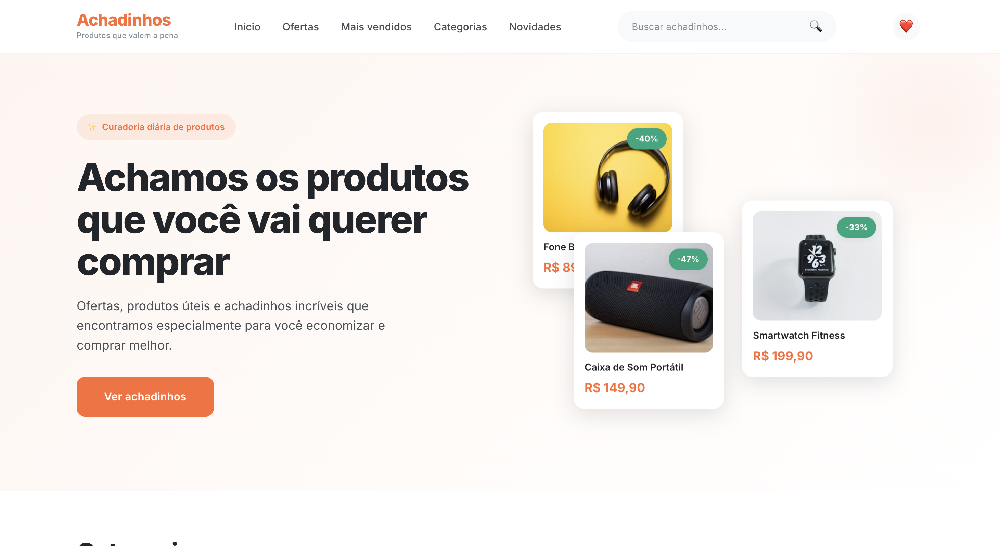
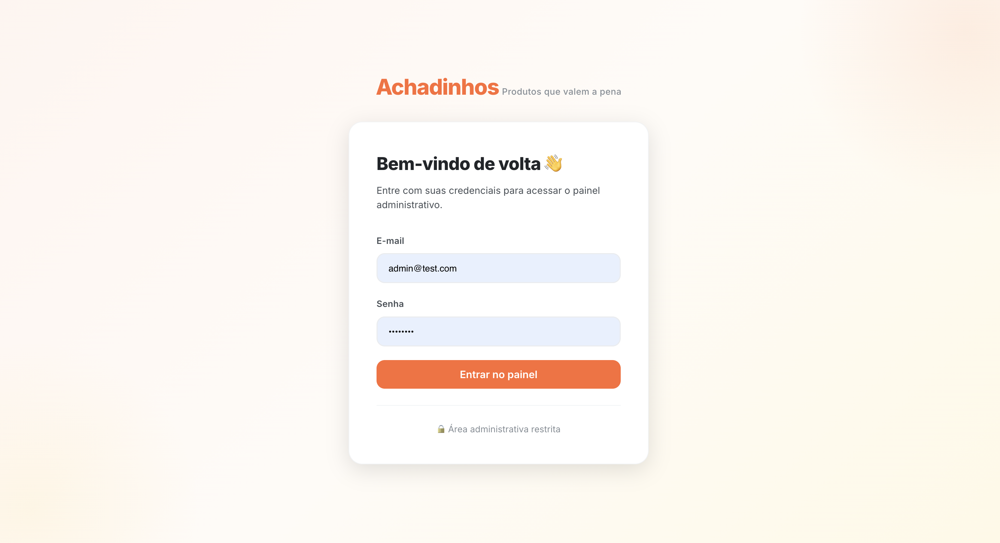
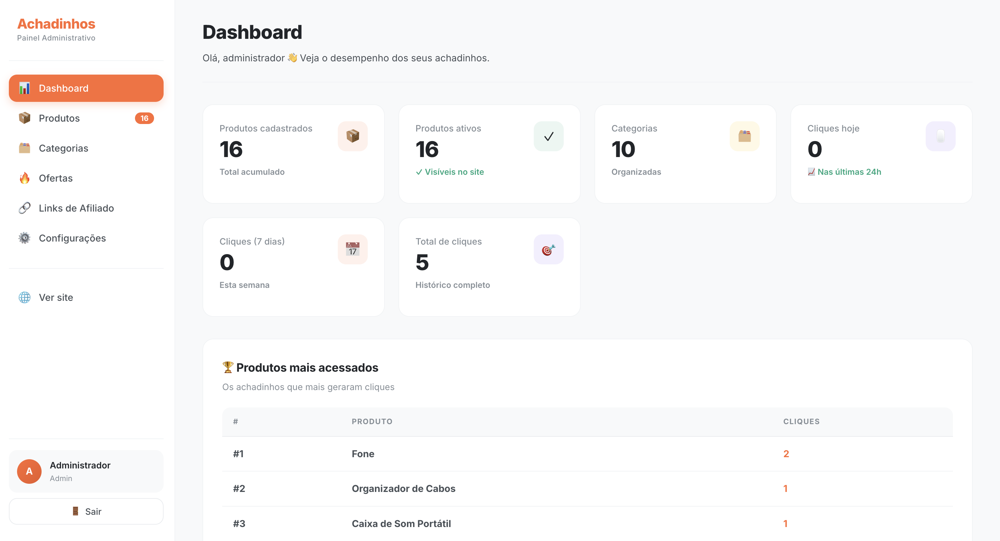
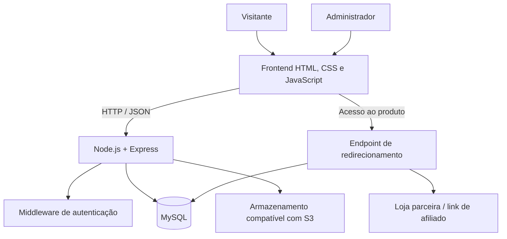

<div align="center">

# Garimpo IA

### Descoberta de produtos, ofertas e oportunidades de compra

Uma aplicação web para organizar produtos, destacar ofertas e direcionar usuários a lojas parceiras por meio de links de afiliados.


</div>

---

## Sobre o projeto

O **Garimpo IA** é um projeto de catálogo e curadoria de produtos. A proposta é centralizar informações de produtos, organizar o conteúdo por categorias, destacar oportunidades e encaminhar o usuário para a página de compra da loja parceira.

O sistema conta com uma interface pública e um painel administrativo. No backend, uma API REST conecta a aplicação ao MySQL, administra os dados e registra os cliques realizados nos links de produtos.

> **Estado atual:** projeto em desenvolvimento. A pontuação de oportunidades disponível no código é baseada em regras de negócio; uma integração com modelo de inteligência artificial ainda precisa ser implementada. O registro de cliques não representa, por si só, confirmação de vendas ou comissões.

## Funcionalidades

### Experiência pública

- Página inicial com destaques e seleções de produtos.
- Catálogo organizado por categorias.
- Busca por produtos.
- Página individual de produto.
- Filtros e ordenação do catálogo.
- Exibição de preço atual, preço anterior e percentual de desconto calculado.
- Redirecionamento para links de afiliados.
- Registro de cliques para acompanhamento de acessos.

### Painel administrativo

- Login administrativo com sessão.
- Dashboard com indicadores de produtos, categorias e cliques.
- Cadastro, consulta, edição e exclusão de produtos.
- Organização por categorias.
- Upload de imagens e vídeos para armazenamento compatível com S3.
- Campos para avaliação, quantidade de avaliações e score de oportunidade.

### Análise de oportunidades

O código contém uma pontuação heurística que considera critérios como percentual de desconto e avaliação do produto. Ela é uma regra determinística, não um modelo de machine learning ou uma integração com IA generativa.

## Demonstração visual

Os prints serão exibidos diretamente nesta página principal do README no GitHub, para que quem visitar o repositório consiga visualizar o projeto sem precisar abrir outra pasta.

Salve as capturas de tela na raiz do repositório, ao lado deste `README.md`, usando estes nomes:

```text
garimpo-ia/
├── README.md
├── home.png
├── catalogo.png
├── produto.png
├── login.png
└── dashboard.png
```

Quando os arquivos estiverem no repositório, as imagens aparecerão aqui:

### Página inicial



### Catálogo de produtos


### Detalhes do produto


### Login administrativo



### Dashboard administrativo



> **Observação:** os espaços acima só exibirão as imagens depois que os arquivos reais forem adicionados à raiz do repositório. Não incluí imagens fictícias como se fossem capturas reais da aplicação. Use dados de demonstração e oculte informações pessoais, credenciais e dados sensíveis nos prints.

## Tecnologias

| Tecnologia | Uso |
|---|---|
| HTML5 | Estrutura das páginas |
| CSS3 | Layout, responsividade e identidade visual |
| JavaScript | Interações e consumo da API no navegador |
| Node.js | Ambiente de execução do servidor |
| Express | Servidor web e endpoints REST |
| MySQL | Persistência dos dados relacionais |
| `mysql2` | Conexão e consultas ao banco |
| `express-session` | Sessões de autenticação |
| `bcryptjs` | Hash e verificação de senhas |
| Multer | Recebimento de arquivos enviados pelo painel |
| AWS SDK S3 | Integração com armazenamento compatível com S3 |
| `dotenv` | Configuração por variáveis de ambiente |

## Arquitetura



### Organização de pastas

```text
garimpo-ia/
├── database/
│   ├── database.js          # Conexão com MySQL
│   ├── schema.sql           # Estrutura inicial do banco
│   └── migrations/          # Evolução do esquema
├── middleware/
│   └── auth.js              # Proteção de rotas administrativas
├── public/
│   ├── css/                 # Estilos da aplicação
│   ├── js/                  # Scripts do frontend
│   ├── index.html           # Página inicial
│   ├── categoria.html       # Catálogo/categorias
│   ├── produto.html         # Detalhes do produto
│   ├── busca.html            # Resultados da busca
│   ├── login.html           # Login administrativo
│   └── admin.html           # Painel administrativo
├── routes/
│   ├── admin.js             # Operações administrativas
│   ├── categorias.js        # Consulta de categorias
│   ├── cliques.js           # Rastreamento e estatísticas
│   ├── lojas.js             # Consulta de lojas
│   └── produtos.js          # Catálogo e filtros
├── utils/
│   └── storage.js           # Upload e exclusão de arquivos
├── .env.example             # Modelo de configuração
├── package.json
└── server.js                # Inicialização do Express
```

> O arquivo ZIP de origem também contém uma pasta `adrimob/`, que corresponde a outra aplicação. Ela não faz parte da arquitetura do Garimpo IA e deve ficar em um repositório separado.

## Como executar localmente

### Pré-requisitos

- Node.js e npm instalados.
- MySQL em execução.
- Acesso a um serviço de armazenamento compatível com S3 para testar uploads de arquivos.

### 1. Instale as dependências

Na pasta raiz do Garimpo IA:

```bash
npm install
```

### 2. Configure as variáveis de ambiente

Crie um arquivo `.env` na raiz usando `.env.example` como referência. Preencha com os dados do seu ambiente:

```dotenv
DB_HOST=localhost
DB_USER=seu_usuario_mysql
DB_PASSWORD=sua_senha_mysql
DB_NAME=garimpo_ia
PORT=3000
SESSION_SECRET=gere_um_segredo_longo_e_aleatorio

STORAGE_ENDPOINT=https://seu-endpoint-s3
STORAGE_REGION=auto
STORAGE_ACCESS_KEY_ID=sua_access_key
STORAGE_SECRET_ACCESS_KEY=sua_secret_key
STORAGE_BUCKET_NAME=seu_bucket
STORAGE_PUBLIC_URL=https://sua-url-publica
```

Não compartilhe nem envie o arquivo `.env` ao GitHub. O segredo de sessão e as credenciais acima são exemplos; substitua todos pelos valores do seu ambiente.

### 3. Crie o banco de dados

Execute o script inicial no MySQL:

```bash
mysql -u seu_usuario_mysql -p < database/schema.sql
```

O projeto também contém a migração `database/migrations/001_multi_loja.sql`, que adiciona informações de lojas e campos de score. Revise e aplique as migrações na ordem correta para a versão do MySQL utilizada. Antes de executar em um banco com dados, faça backup e confirme se a migração já foi aplicada.

> **Atenção:** o esquema inicial e algumas operações de cadastro precisam ser alinhados quanto aos campos de imagens e vídeo. Se ocorrer erro de coluna inexistente, confira o esquema e as migrações antes de continuar.

### 4. Inicie a aplicação

Modo normal:

```bash
npm start
```

Modo de desenvolvimento, com reinicialização automática:

```bash
npm run dev
```

A aplicação utiliza a porta definida em `PORT` ou, por padrão, a porta `3000`.

- Site: <http://localhost:3000>
- Login: <http://localhost:3000/login>
- Painel: <http://localhost:3000/admin>

O servidor tenta conectar ao MySQL durante a inicialização. Se a conexão falhar, confira o serviço, o nome do banco e as credenciais.

### Acesso administrativo local

O código atual cria uma conta administrativa inicial quando a tabela `usuarios` está vazia. As credenciais padrão estão definidas no código do servidor e **não devem ser utilizadas em produção**. Antes de disponibilizar a aplicação publicamente, altere esse fluxo, defina uma senha segura e configure um segredo de sessão forte.

## API — principais rotas

| Método | Rota | Descrição |
|---|---|---|
| `GET` | `/api/produtos` | Lista produtos com filtros e ordenação |
| `GET` | `/api/produtos/:slug` | Consulta um produto pelo slug |
| `GET` | `/api/produtos/populares` | Lista produtos populares conforme a regra atual |
| `GET` | `/api/produtos/destaque/dia` | Consulta o produto em destaque |
| `GET` | `/api/categorias` | Lista categorias ativas |
| `POST` | `/api/admin/login` | Autenticação administrativa |
| `POST` | `/api/admin/logout` | Encerramento da sessão |
| `GET` | `/api/admin/dashboard` | Indicadores do painel |
| `GET` | `/api/admin/produtos` | Lista produtos no painel |
| `POST` | `/api/admin/produtos` | Cadastra um produto |
| `PUT` | `/api/admin/produtos/:id` | Atualiza um produto |
| `DELETE` | `/api/admin/produtos/:id` | Exclui um produto |
| `GET` | `/redirect/:id` | Registra o clique e redireciona para o parceiro |

A lista é resumida e reflete as rotas presentes no código. Algumas rotas adicionais podem exigir configuração ou correções antes de serem utilizadas.

## Segurança e limitações conhecidas

Antes de usar em produção, recomendo revisar os seguintes pontos:

- Remover segredos e credenciais do ambiente versionado; manter `.env` fora do Git.
- Trocar a senha administrativa inicial e o segredo de sessão padrão.
- Configurar cookies seguros e armazenamento persistente de sessões em produção.
- Validar o conteúdo real dos arquivos enviados, além da extensão e do tamanho.
- Alinhar o esquema SQL às colunas usadas no cadastro e edição de produtos.
- Registrar todas as rotas que realmente serão expostas, incluindo a rota de lojas se for necessária.
- Revisar consultas de ordenação para garantir compatibilidade com a versão do MySQL.
- Adicionar testes automatizados para autenticação, CRUD, filtros, uploads e redirecionamentos.
- Diferenciar cliques registrados de conversões e comissões confirmadas pelos parceiros.

## Próximos passos

- [ ] Corrigir e validar as migrações do banco de dados.
- [ ] Completar e testar o CRUD administrativo de categorias.
- [ ] Integrar corretamente as rotas de lojas.
- [ ] Ajustar a ordenação por popularidade com base nos cliques reais.
- [ ] Implementar testes automatizados de API.
- [ ] Adicionar prints reais da aplicação em `docs/screenshots/`.
- [ ] Integrar um provedor de IA, caso a análise generativa faça parte do escopo futuro.
- [ ] Preparar configuração de produção, logs e monitoramento.

## Objetivo de aprendizado

Este projeto reúne práticas de desenvolvimento web full-stack: criação de uma API REST, integração com banco relacional, autenticação por sessão, upload de arquivos, filtros de catálogo e rastreamento de eventos.

---

<div align="center">

Desenvolvido como projeto de estudo e evolução em desenvolvimento web.

</div>
